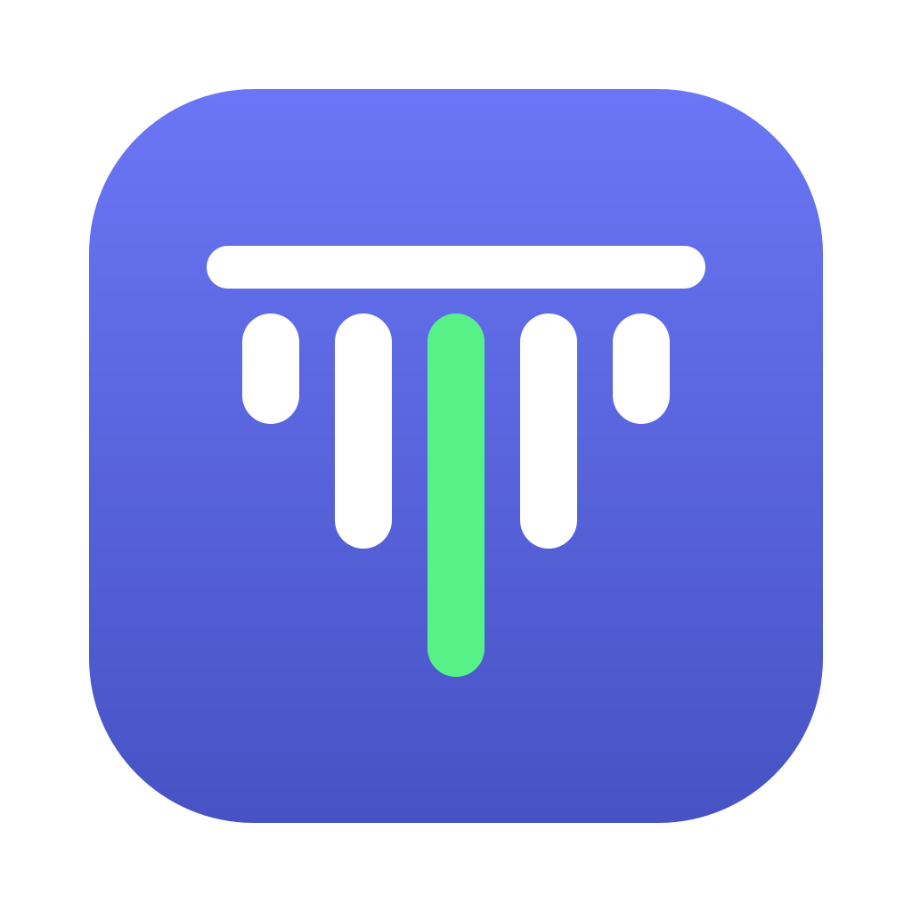
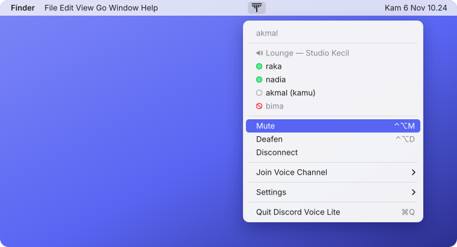

<p align="center">
  
</p>

<h1 align="center">Discord Voice Lite</h1>

<p align="center">
  Voice chat Discord langsung dari menu bar macOS — tanpa membuka aplikasi Discord yang berat.
</p>

<p align="center">
  
</p>

## Tentang

Discord Voice Lite adalah aplikasi menu bar untuk macOS yang hanya melakukan satu hal: **masuk ke voice channel Discord dan ngobrol**. Tidak ada jendela chat, tidak ada Electron. Audio diproses native lewat `AVAudioEngine` (echo cancellation, noise suppression, AGC bawaan macOS), sedangkan koneksi ke Discord ditangani daemon Python kecil di belakang layar.

Cocok kalau kamu sering nongkrong di voice channel sambil kerja dan ingin hemat RAM serta baterai.

## Fitur

- **Join, pindah, dan keluar voice channel** dari menu bar; daftar server & channel lengkap dengan siapa saja yang ada di dalamnya.
- **Mute / Deafen** lewat menu atau hotkey global <kbd>⌃⌥M</kbd> / <kbd>⌃⌥D</kbd> (tanpa izin Accessibility).
- **Ikon menu bar hidup** — bar pada logo beranimasi saat ada yang bicara; garis miring saat mute/deafen.
- **Indikator siapa yang sedang bicara** di daftar anggota channel.
- **Tahan sinyal jelek** — reorder paket, Opus FEC + PLC untuk paket hilang, dan jitter buffer adaptif sehingga suara tidak putus-putus.
- **Pilih device input/output** (mic & speaker) sendiri, terpisah dari default sistem.
- **Sensitivitas mic** (voice activity detection) tiga tingkat.
- **Auto-join** ke channel terakhir saat aplikasi dibuka.
- Token disimpan di **Keychain** macOS.

## Persyaratan

- macOS 13 Ventura atau lebih baru, Apple Silicon (arm64)
- Untuk build: Xcode Command Line Tools, [uv](https://docs.astral.sh/uv/), dan Homebrew `opus`

## Build & jalankan

```bash
brew install opus
cd daemon && uv sync && cd ..
./menubar/build.sh
open menubar/build/DiscordVoiceLite.app
```

Build dev memakai virtualenv di `daemon/.venv`, jadi repo ini harus tetap ada di disk.

### Build rilis (self-contained)

```bash
./packaging/package.sh
```

Menghasilkan `dist/DiscordVoiceLite-<versi>.dmg` yang sudah membundel Python runtime, daemon, dan libopus — cukup seret ke folder Applications.

Saat pertama dibuka, aplikasi meminta token Discord akun kamu (disimpan di Keychain) dan izin mikrofon saat kamu unmute.

## Cara kerja

```
┌──────────────── Discord Voice Lite.app ────────────────┐
│  Menu bar UI (Swift/AppKit)                             │
│  AudioIO: AVAudioEngine + Voice Processing I/O          │
│    · mic → PCM 48 kHz      · mixing & jitter buffer     │
└──────────┬───────────────────────────────▲──────────────┘
   stdin/stdout JSON (perintah & event)     │ Unix socket (PCM)
┌──────────▼───────────────────────────────┴──────────────┐
│  daemon/discordlight.py (discord.py-self + native voice)│
│    · login, gateway, voice connection                   │
│    · Opus encode (FEC) / decode + reorder + PLC         │
└─────────────────────────────────────────────────────────┘
```

| Folder | Isi |
|---|---|
| `menubar/` | Aplikasi menu bar (Swift): UI, audio engine, hotkey, Keychain |
| `daemon/` | Daemon voice Python |
| `packaging/` | Script build rilis DMG dan generator ikon |
| `brand/` | Logo & app icon (SVG) |

Log ada di `~/Library/Logs/DiscordVoiceLite/` (`app.log` dan `daemon.log`), bisa dibuka dari **Settings → Buka Log**.

## Disclaimer

Proyek ini **tidak berafiliasi dengan, didukung, atau disponsori oleh Discord Inc.** "Discord" adalah merek dagang milik Discord Inc.

Aplikasi ini login memakai token akun pengguna (self-bot), yang **melanggar [Ketentuan Layanan Discord](https://discord.com/terms)** dan bisa berujung pada pemblokiran akun. Gunakan dengan risiko sendiri.
